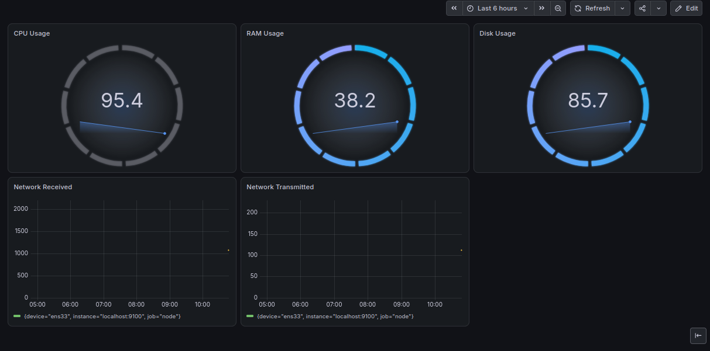

# Linux Server Health Monitor

A modular Linux server monitoring tool built using Bash scripting. It monitors system resources, checks essential services and network connectivity, generates health reports, records logs, and raises warning or critical alerts.

The project also includes scheduled execution, automated cleanup, Docker containerization, automated testing, GitHub Actions CI, and a Prometheus + Node Exporter + Grafana monitoring stack.

## Features

- CPU load and utilization monitoring
- Memory and swap utilization monitoring
- Disk space and inode monitoring
- Top CPU and memory-consuming processes
- SSH service status check
- Network connectivity and DNS checks
- Network interface and listening port diagnostics
- Failed SSH login and system journal diagnostics
- Configurable warning and critical thresholds
- Timestamped health reports
- Centralized application logging
- Warning and critical alert notifications
- Automated execution using cron
- Automatic report and log retention cleanup
- Docker containerization
- Automated Bats tests
- ShellCheck static analysis
- GitHub Actions CI pipeline
- Prometheus and Node Exporter system metrics monitoring
- Grafana dashboards and CPU/RAM alert rules

## Project Structure

```text
linux-server-health-monitor/
├── .github/
│   └── workflows/
│       └── ci.yml
├── config/
│   └── monitor.conf
├── lib/
│   ├── alerting.sh
│   ├── config_validation.sh
│   ├── cpu_health.sh
│   ├── disk_health.sh
│   ├── logging.sh
│   ├── memory_health.sh
│   ├── process_health.sh
│   ├── swap_health.sh
│   └── system_diagnostics.sh
├── tests/
│   ├── alerting.bats
│   ├── cleanup.bats
│   ├── config_validation.bats
│   ├── disk_collection.bats
│   ├── disk_health.bats
│   ├── health_check.bats
│   ├── logging.bats
│   ├── memory_health.bats
│   └── swap_health.bats
├── reports/
├── logs/
├── cleanup.sh
├── Dockerfile
├── health_check.sh
├── run_monitor.sh
├── .gitignore
└── README.md
```

## Requirements

### Runtime requirements

- Linux operating system
- Bash
- Standard Linux utilities:
  - awk / gawk
  - df and free
  - getent and grep
  - ip and ss
  - lscpu and ps
  - ping
  - systemctl and journalctl
  - find and other standard utilities
- Git

### Development tools

- Bats for automated shell testing
- ShellCheck for static analysis
- Docker Engine for container execution

### Monitoring tools

- Prometheus
- Prometheus Node Exporter
- Grafana

## Installation

Clone the repository:

```bash
git clone https://github.com/Pratham104530/linux-server-health-monitor.git
cd linux-server-health-monitor
```

Make the scripts executable:

```bash
chmod +x health_check.sh run_monitor.sh cleanup.sh
```

## Configuration

Edit `config/monitor.conf` to adjust monitoring thresholds.

Example:

```bash
# CPU thresholds
CPU_LOAD_THRESHOLD=1
CPU_WARNING_THRESHOLD=80
CPU_CRITICAL_THRESHOLD=95

# Memory thresholds
MEMORY_WARNING_THRESHOLD=80
MEMORY_CRITICAL_THRESHOLD=95

# Disk thresholds
DISK_WARNING_THRESHOLD=80
DISK_CRITICAL_THRESHOLD=95

# Inode thresholds
INODE_WARNING_THRESHOLD=80
INODE_CRITICAL_THRESHOLD=95

# Swap thresholds
SWAP_WARNING_THRESHOLD=80
SWAP_CRITICAL_THRESHOLD=95
```

The configuration validator checks that threshold values are numeric and that warning thresholds are lower than critical thresholds.

## Usage

Run the monitoring script from the repository root:

```bash
./health_check.sh
```

The monitor displays system health information, generates a timestamped report in `reports/`, and records execution events in `logs/monitor.log`.

Some system journal and service checks may require elevated privileges or suitable journal permissions.

## Automated Scheduling

The project supports scheduled execution using cron.

The `run_monitor.sh` script runs the health monitor from the project directory.

Example cron schedule:

```cron
*/5 * * * * /home/prathamesh/linux-server-health-monitor/run_monitor.sh
```

This example executes monitoring every five minutes. Update the path if the repository is stored elsewhere.

## Report and Log Retention

The `cleanup.sh` script manages old generated files.

Current retention policy:

- Health reports older than 7 days are deleted.
- Rotated log files older than 30 days are deleted.
- Active application logs are preserved.

The cleanup script can be scheduled using cron.

## Alert Notifications

The alerting module records warning and critical alerts in:

```text
logs/alerts.log
```

Alerts are generated according to the overall monitoring status and configured thresholds.

## Docker Usage

Build the Docker image:

```bash
sudo docker build -t linux-server-health-monitor:1.0 .
```

Run the container:

```bash
sudo docker run --rm \
  --name health-monitor \
  -v "$(pwd)/reports:/app/reports" \
  -v "$(pwd)/logs:/app/logs" \
  linux-server-health-monitor:1.0
```

### Docker Notes

- Reports and logs are saved on the host using volume mounts.
- The container monitors its own environment, not the complete host system.
- Host-only checks such as SSH service status and system journal access are skipped or unavailable inside the container.
- The container is removed after execution because the example uses `--rm`.
- Docker Engine must be installed before running these commands.

## Prometheus & Node Exporter Monitoring

Prometheus and Node Exporter collect and monitor Linux system metrics.

### Components

- **Prometheus:** Collects and stores monitoring metrics.
- **Node Exporter:** Exposes Linux system metrics such as CPU, memory, disk, and network usage.

### Installation

Install both packages on Ubuntu:

```bash
sudo apt update
sudo apt install -y prometheus prometheus-node-exporter
```

### Services

Check service status:

```bash
sudo systemctl status prometheus
sudo systemctl status prometheus-node-exporter
```

Both services should be active and running.

### Prometheus Configuration

Configuration file:

```text
/etc/prometheus/prometheus.yml
```

Node Exporter scrape target:

```yaml
- job_name: node
  static_configs:
    - targets: ['localhost:9100']
```

Prometheus uses a global scrape interval of 15 seconds in this setup.

### Access Prometheus

Open:

```text
http://localhost:9090
```

Check monitoring targets:

```text
http://localhost:9090/targets
```

Both Prometheus and Node Exporter targets should show as **UP**.

If accessing Prometheus from Windows while it runs inside an Ubuntu VM, use:

```text
http://<UBUNTU_VM_IP>:9090
```

Find the VM IP:

```bash
hostname -I
```

### PromQL Queries

**CPU usage percentage:**

```promql
100 - (avg by (instance) (rate(node_cpu_seconds_total{mode="idle"}[5m])) * 100)
```

**Memory usage percentage:**

```promql
100 * (1 - (node_memory_MemAvailable_bytes / node_memory_MemTotal_bytes))
```

**Root disk usage percentage:**

```promql
100 * (1 - (node_filesystem_avail_bytes{mountpoint="/",fstype="ext4"} / node_filesystem_size_bytes{mountpoint="/",fstype="ext4"}))
```

## Grafana Dashboards & Alerting

Grafana visualizes metrics collected by Prometheus and evaluates alert rules.

### Access Grafana

Open:

```text
http://localhost:3000
```

When accessing Grafana from Windows while it runs inside an Ubuntu VM:

```text
http://<UBUNTU_VM_IP>:3000
```

Find the VM IP:

```bash
hostname -I
```

Configure Prometheus as a Grafana data source using:

```text
http://localhost:9090
```

Use the VM address instead of `localhost` when Grafana and Prometheus are on different machines.

### Configured alert rules

The project includes Grafana alert rules for:

| Alert | Metric | Condition |
|---|---|---|
| High CPU Usage | CPU utilization | Configured threshold |
| High RAM Usage | Memory utilization | Above 80% |

RAM alert PromQL expression:

```promql
100 * (1 - (node_memory_MemAvailable_bytes / node_memory_MemTotal_bytes))
```

The RAM alert is configured with an 80% threshold and a 1-minute pending period.

Alert states can be checked under **Alerting → Alert rules** in Grafana.

### Notification configuration

A Grafana contact point named `Linux Alert Notifications` is configured with an email recipient.

SMTP has intentionally been left unconfigured, so email delivery has not been enabled or verified. To receive email notifications, configure a valid SMTP server in Grafana and test delivery from the contact point.

## Health Status and Exit Codes

The monitoring script returns an exit code based on overall system health.

| Exit code | Status | Meaning |
|---|---|---|
| 0 | OK | Checks are within configured limits |
| 1 | WARNING | A warning threshold was reached or a check could not be completed |
| 2 | CRITICAL | A critical resource threshold was reached |

Check the exit code of the previous command:

```bash
echo $?
```

## Testing

Run all automated tests:

```bash
bats tests/
```

Check Bash syntax:

```bash
bash -n health_check.sh run_monitor.sh cleanup.sh lib/*.sh
```

Run ShellCheck, including sourced files:

```bash
shellcheck -x health_check.sh run_monitor.sh cleanup.sh lib/*.sh
```

## Continuous Integration

GitHub Actions automatically runs the following checks on pushes and pull requests targeting `main`:

- Bash syntax validation
- ShellCheck static analysis
- Bats automated tests

Workflow file:

```text
.github/workflows/ci.yml
```

## Generated Files

| Directory | Contents |
|---|---|
| `reports/` | Timestamped health reports |
| `logs/` | Application, cron, and alert logs |

Generated reports and logs are excluded from Git using `.gitignore`.

## Current Project Scope

### Implemented

- Modular resource monitoring
- Configuration validation
- Timestamped reports and centralized logging
- CPU and memory process monitoring
- SSH, system journal, and network diagnostics
- Automated Bats tests and ShellCheck validation
- Scheduled monitoring using cron
- Automatic report and log retention cleanup
- Warning and critical alert notifications
- GitHub Actions CI pipeline
- Docker containerization
- Prometheus and Node Exporter integration
- Grafana dashboards and CPU/RAM alert rules

## Purpose

This project demonstrates practical Linux system administration, Bash scripting, automation, monitoring, troubleshooting, Docker fundamentals, CI/CD concepts, automated testing, Prometheus monitoring, Grafana alerting, and Git-based development.

## Grafana Monitoring Dashboard
 
### System Monitoring Dashboard
 

### CPU Alert Rule


### RAM Alert Rule

